# Active Directory & Windows Server Help Desk Lab

## Project Overview

This project demonstrates hands-on experience configuring and administering a Windows Server Active Directory environment using Oracle VirtualBox.

I built a simulated corporate network consisting of a Windows Server domain controller and a Windows 11 Pro workstation. The lab focuses on Active Directory administration, user account management, security groups, Group Policy, DNS, domain authentication, and common Tier 1 IT Help Desk troubleshooting tasks.

## Technologies Used

- Windows Server 2022
- Windows 11 Pro
- Oracle VirtualBox
- Active Directory Domain Services (AD DS)
- DNS
- Group Policy Management
- Active Directory Users and Computers (ADUC)
- Windows Command Prompt

## Lab Environment

| Component | Configuration |
|---|---|
| Domain | `corp.novatech.com` |
| NetBIOS Domain | `CORP` |
| Domain Controller | `CORP-DC01` |
| Windows Client | `CORP-WIN01` |
| Domain Controller IP | `192.168.100.10` |
| Subnet | `192.168.100.0/24` |
| Network | VirtualBox NAT Network (`CorpLab-NAT`) |
| Client Operating System | Windows 11 Pro |

## Lab Implementation

### 1. Virtual Machine and Server Configuration

Created a Windows Server virtual machine in VirtualBox, configured virtual hardware, established a NAT Network, and installed Windows Server.

Renamed the server `CORP-DC01` and configured a static IPv4 address.

**Server Manager Dashboard**

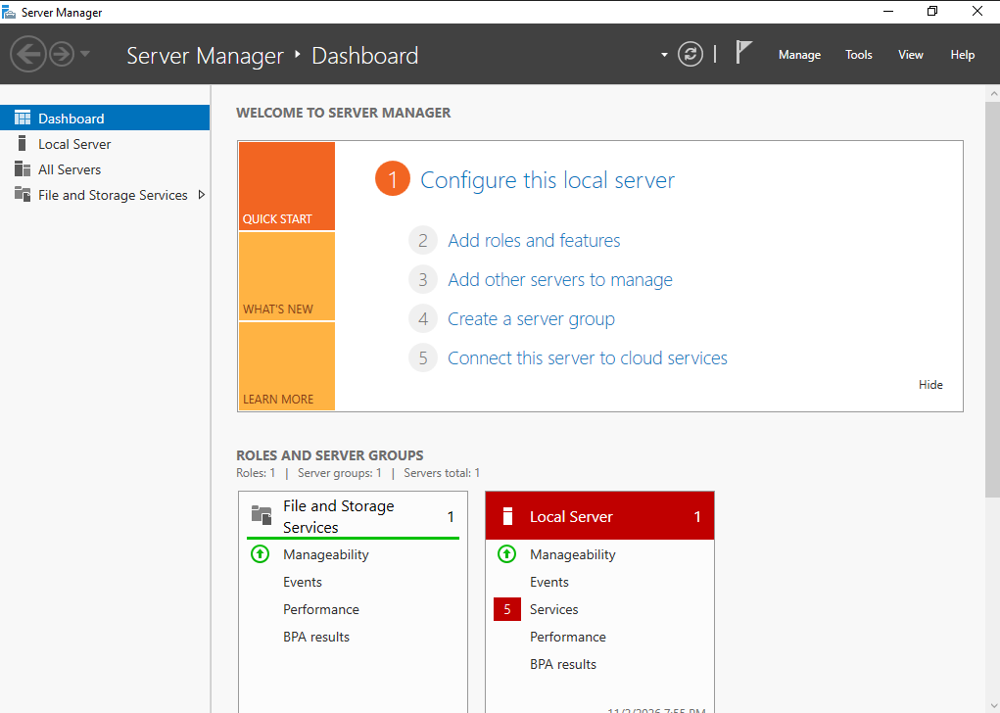

**Static IP Configuration**

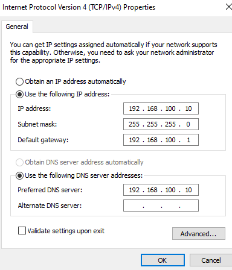

**Network Verification**

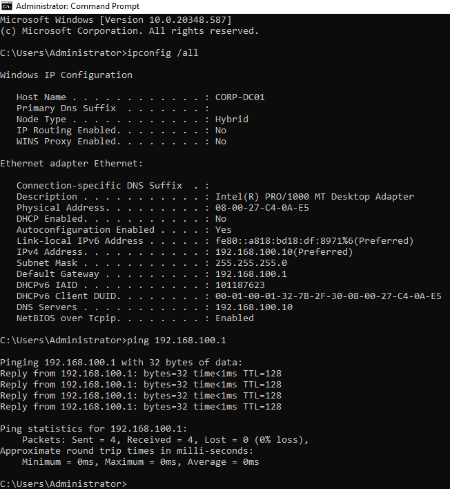

### 2. Active Directory Domain Services

Installed Active Directory Domain Services and promoted `CORP-DC01` to a domain controller.

Created the Active Directory forest `corp.novatech.com` and configured DNS and Global Catalog services.

**AD DS Installation**

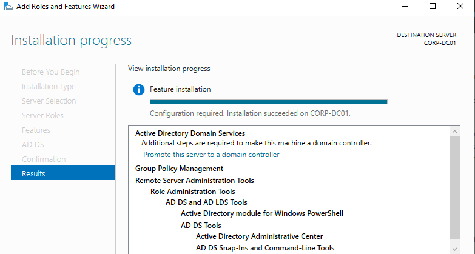

**Domain Configuration**

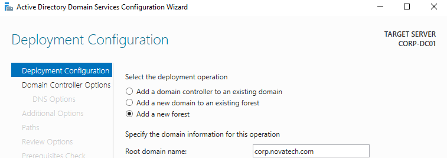

**Active Directory Domain**

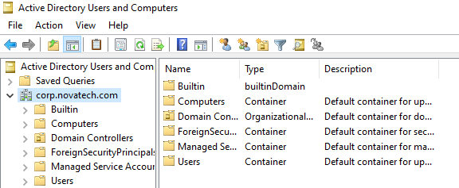

### 3. Organizational Units and User Administration

Created a Corporate Organizational Unit containing departmental OUs for IT, Human Resources, Finance, Sales, Workstations, and Servers.

Created fictional employee accounts and configured account logon settings.

**Organizational Units**

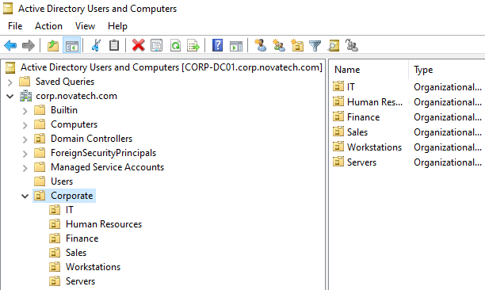

**IT User Accounts**

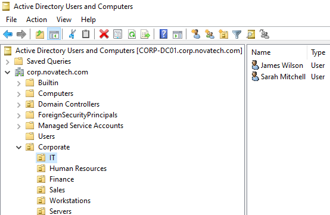

**User Account Properties**

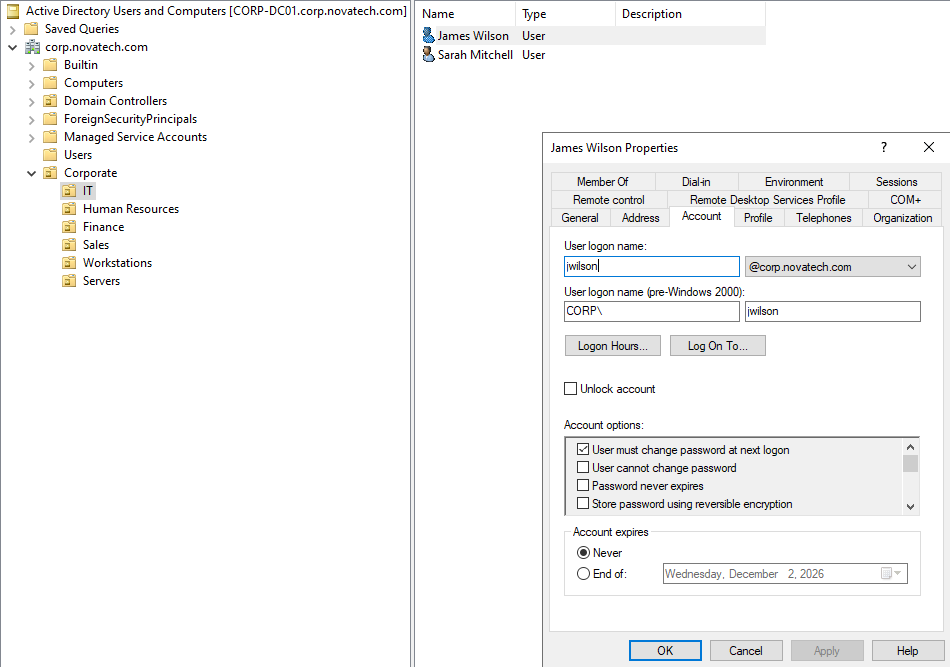

### 4. Security Group Management

Created departmental global security groups and assigned employees to their corresponding groups.

Practiced managing group membership through Active Directory Users and Computers.

**Security Group**

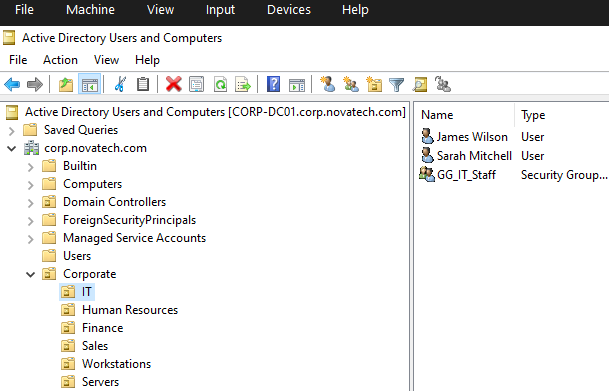

**Group Membership**

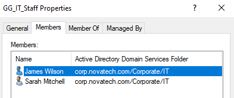

### 5. Group Policy Configuration

Created and linked a Group Policy Object named `Workstation Security Policy` to the Workstations OU.

Configured a 900-second (15-minute) inactivity limit for domain-joined workstations.

**Group Policy Object**

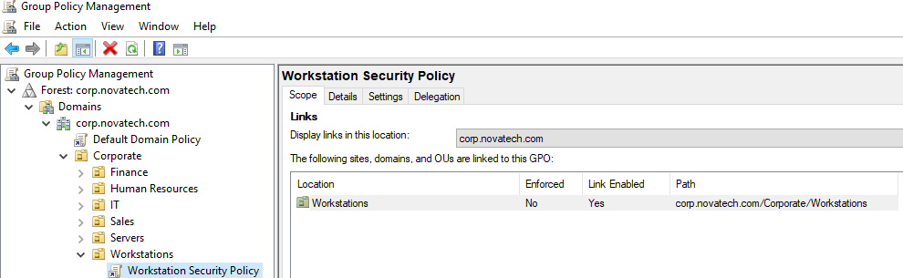

**Security Policy Configuration**

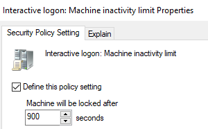

### 6. Windows Client Domain Integration

Installed Windows 11 Pro on a second VirtualBox VM named
