# Active Directory & Windows Server Help Desk Lab

## Project Overview

This project demonstrates hands-on experience configuring and administering a Windows Server Active Directory environment using Oracle VirtualBox.

I built a simulated corporate network consisting of a Windows Server domain controller and a Windows 11 Pro workstation. The lab focuses on Active Directory administration, user account management, security groups, Group Policy, DNS, domain authentication, and common Tier 1 IT Help Desk troubleshooting tasks.

## Technologies Used

- Windows Server 2022
- Windows 11 Pro
- Oracle VirtualBox
- Active Directory Domain Services (AD DS)
- DNS
- Group Policy Management
- Active Directory Users and Computers (ADUC)
- Windows Command Prompt

## Lab Environment

| Component | Configuration |
|---|---|
| Domain | `corp.novatech.com` |
| NetBIOS Domain | `CORP` |
| Domain Controller | `CORP-DC01` |
| Windows Client | `CORP-WIN01` |
| Domain Controller IP | `192.168.100.10` |
| Subnet | `192.168.100.0/24` |
| Network | VirtualBox NAT Network (`CorpLab-NAT`) |
| Client Operating System | Windows 11 Pro |

## Lab Implementation

### 1. Virtual Machine and Server Configuration

Created a Windows Server virtual machine in VirtualBox, configured virtual hardware, established a NAT Network, and installed Windows Server.

Renamed the server `CORP-DC01` and configured a static IPv4 address.

**Server Manager Dashboard**

**Static IP Configuration**

**Network Verification**

### 2. Active Directory Domain Services

Installed Active Directory Domain Services and promoted `CORP-DC01` to a domain controller.

Created the Active Directory forest `corp.novatech.com` and configured DNS and Global Catalog services.

**AD DS Installation**

**Domain Configuration**

**Active Directory Domain**

### 3. Organizational Units and User Administration

Created a Corporate Organizational Unit containing departmental OUs for IT, Human Resources, Finance, Sales, Workstations, and Servers.

Created fictional employee accounts and configured account logon settings.

**Organizational Units**

**IT User Accounts**

**User Account Properties**

### 4. Security Group Management

Created departmental global security groups and assigned employees to their corresponding groups.

Practiced managing group membership through Active Directory Users and Computers.

**Security Group**

**Group Membership**

### 5. Group Policy Configuration

Created and linked a Group Policy Object named `Workstation Security Policy` to the Workstations OU.

Configured a 900-second (15-minute) inactivity limit for domain-joined workstations.

**Group Policy Object**

**Security Policy Configuration**

### 6. Windows Client Domain Integration

Installed Windows 11 Pro on a second VirtualBox VM named `CORP-WIN01`.

Configured the client to use the domain controller for DNS and successfully joined the workstation to `corp.novatech.com`.

Verified Active Directory authentication using a fictional domain user account.

**Windows 11 Client**

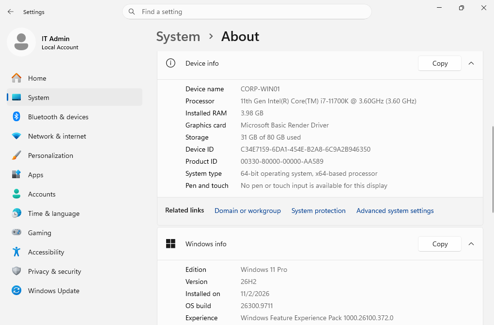

**DNS Configuration**

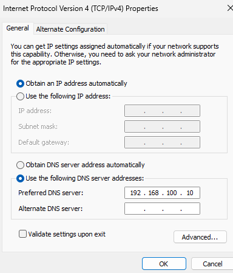

**Domain Controller Discovery**

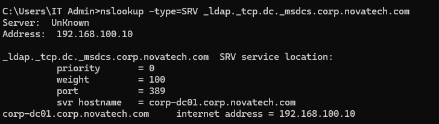

**Domain Membership**

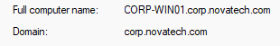

**Domain User Authentication**

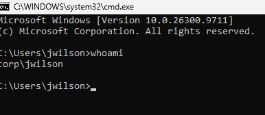

### 7. Group Policy Verification

Refreshed Group Policy on the domain-joined Windows workstation using:

`gpupdate /force`

Verified the applied Group Policy Objects using:

`gpresult /r /scope computer`

Confirmed that the Workstation Security Policy and Default Domain Policy were successfully applied.

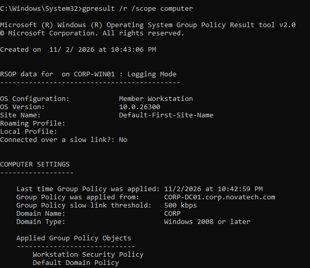

### 8. Active Directory Password Reset

Simulated a help desk password reset request for a fictional employee.

Reset the employee's password through Active Directory Users and Computers and required a password change at the next logon.

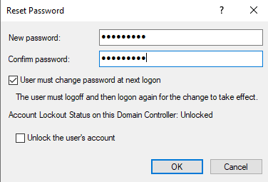

### 9. Account Lockout and Recovery

Configured an Active Directory account lockout policy with:

- Account lockout threshold: 5 invalid logon attempts
- Lockout duration: 15 minutes
- Reset account lockout counter: 15 minutes

Created a dedicated test account, intentionally triggered an account lockout, and unlocked the account using Active Directory Users and Computers.

Verified successful authentication afterward.

**Account Lockout Policy**

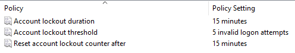

**Test User**

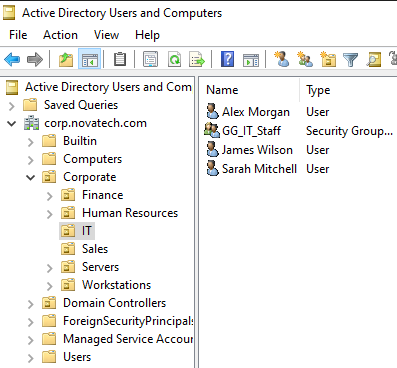

**Account Lockout**

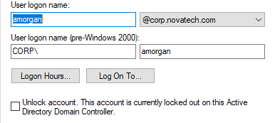

**Account Unlock**

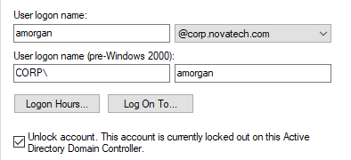

## Skills Demonstrated

- Windows Server Administration
- Active Directory Domain Services
- Domain Controller Configuration
- DNS Configuration and Troubleshooting
- Organizational Unit Management
- User Account Provisioning
- Security Group Administration
- Group Policy Configuration and Verification
- Windows Domain Joining
- Domain User Authentication
- Active Directory Password Resets
- Account Lockout Troubleshooting
- Virtual Machine and Network Configuration
- IT Help Desk Documentation

## Project Outcome

Successfully deployed and administered a functioning Active Directory domain in an isolated VirtualBox lab.

Configured a Windows Server domain controller, joined a Windows 11 workstation to the domain, managed fictional employee accounts and security groups, applied Group Policy, and completed hands-on password reset and account lockout recovery exercises.

This project demonstrates foundational Windows system administration and Tier 1 IT Help Desk skills relevant to enterprise support environments.
